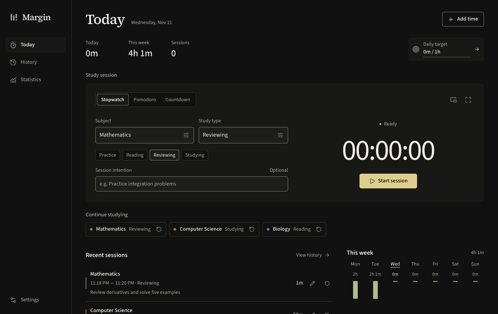
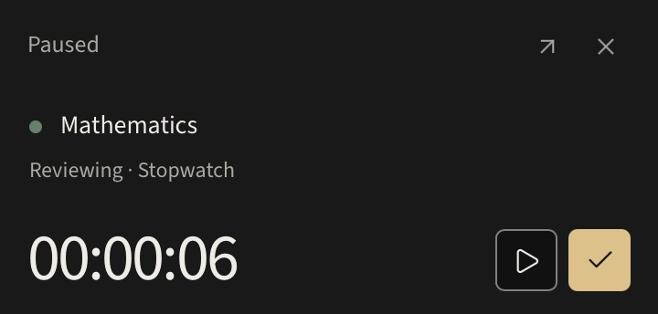

<p align="center"></p>
<h1 align="center">Margin</h1>
<p align="center">Study time, recorded locally.</p>

Margin is a small desktop app for keeping track of study time and seeing where the hours go. It runs locally, saves your sessions as you study, and turns your history into a useful record. There are no accounts or cloud services.

Choose a subject and a study type, then start. Reviewing calculus and practicing calculus belong to the same subject, but tell different stories about how you spend your time. You can use the built-in study types or add your own.

<p align="center"></p>

<details>


</details>

## What it does

- Stopwatch, Pomodoro and Countdown with pause, resume, restart recovery and optional notes.
- Subjects and study types you can create inline, rename, color and archive. Unused choices can be deleted.
- A separate, always-on-top native mini timer and fullscreen focus.
- Searchable session history, manual entries, sorting, repeat preparation and subject/study-type/date filters.
- Filtered statistics with labeled trends, subject/type distributions, a subject × study-type matrix and month/year calendars.
- Monthly and yearly Study Wrapped recaps based on recorded sessions.
- Optional session intentions and daily study targets, disabled by default.
- Six coordinated three-color themes: Carbon with Sage, Fern or Atlantic; Paper with Olive, Ochre or Plum. Editorial, Humanist and Mono text options, all offline.
- JSON backups, CSV history and validated restore with a safety backup.

<p align="center"></p>

## Install

Download the [Margin 0.4.0 Apple Silicon macOS installer](https://github.com/parthapatel114-rgb/margin/releases/download/v0.4.0/Margin_0.4.0_macOS_arm64.dmg) or choose the app ZIP from [the release page](https://github.com/parthapatel114-rgb/margin/releases/tag/v0.4.0). Open the disk image and drag Margin to Applications. It runs without Node.js, Rust or a separate database installation. macOS 12 or newer is the configured minimum; the native build has been exercised on Apple Silicon macOS.

macOS builds use an ad-hoc signature for local bundle integrity. They are not Developer ID signed or notarized. macOS may block them until you explicitly approve the app in Privacy & Security. Do not treat them as signed releases.

Windows x64 packaging is configured for NSIS and MSI. The Windows workflow must run on Windows before a Windows installer can be called verified. Intel macOS builds are configured in the release workflow but have not been run locally. See [verification](docs/verification.md) for the exact tested scope.

## Using Margin

Choose a suggested subject or type your own, choose a study type, and press Start. An optional intention is saved as the session note. New names are created inline. Finish saves with one click; adding a note is optional. Use History to add forgotten time, search notes, filter dates, sort, correct a session or remove it. Repeat and Continue prepare the same subject/type without starting time unexpectedly.

Switch modes above the timer. Stopwatch counts up; Countdown stops at your chosen duration. Pomodoro saves each completed focus session and starts a short break, with a long break after every fourth completed focus session. Breaks never count toward study totals. Start each next focus session yourself. Focus, break and countdown lengths are editable from 1–240 minutes.

The small window icon opens the always-pinned mini timer. Both windows control the same session. Closing the mini window leaves the timer alone. Closing the main window exits the app; an unfinished session is restored next time.

Running time includes computer sleep and time while Margin is closed. Paused time does not count. Pomodoro and Countdown stop at their exact active-time target, including after sleep or restart; they cannot silently create further focus sessions. If you forget to stop a session, finish it and edit its start or study minutes in History. Changing a session’s time replaces its pause intervals with a continuous manual entry; note-only edits preserve all intervals.

Space pauses or resumes when you are not typing or using a control. Command/Ctrl K focuses the subject, Command/Ctrl M opens the mini timer, Command/Ctrl 1 returns to Today, Command/Ctrl 2 opens History, Command/Ctrl 3 opens Statistics, and Escape leaves fullscreen.

## Statistics

Choose Week, Month, Year, All time or a custom range. Filter by subject and study type. Overview shows the main totals and labeled trends; selecting a bar opens matching history. Study mix shows recorded time for each subject/type combination. Calendar offers full month cells with day totals and a year overview; select a day for a breakdown and its sessions. Hourly activity and session methods are under Study patterns. Manual entries are kept separate from timer modes. Wrapped becomes available after at least three sessions across three days in the selected month or year.

Statistics use finished sessions. Today also includes the current timer. Active intervals are split at day and hour boundaries, so a session across midnight or a pause contributes only its actual time to each bucket. Calendar views use the computer’s current time zone; changing zones can move history between days without changing elapsed totals. Original recording zones are preserved.

The 0.4 interface uses a restrained study-ledger layout, Source Serif 4 headings and Source Sans 3 body text. Timer drafts stay in the window when navigating; changed entry forms ask before discarding. Field errors identify how to recover, and native failures offer a saved-state refresh without automatically repeating a write. See [the design tokens and state handling](docs/redesign-0.4.md).

The optional daily target is set from Today. Progress uses actual recorded study time; edit it or disable it from the same control. The shared date picker supports presets, reversed range selection, direct date entry and keyboard arrows, Home/End and Page Up/Down.

## Your data

The SQLite database is stored in the operating system’s application-data directory under `app.margin.study`, outside the installation and source folders. On macOS this is `~/Library/Application Support/app.margin.study/`; on Windows it is normally `%APPDATA%\app.margin.study\`. Updates run versioned migrations without replacing your database.

Settings → Data exports all records as JSON, including any unfinished timer. CSV contains finished sessions with subjects, study types, timer modes, UTC start/end times, active and paused seconds, notes and recording zones. Spreadsheet-formula prefixes in text are escaped in CSV.

Restoring a JSON backup replaces current data after validation and confirmation. First finish or discard any active session, and finish or skip a break. Margin writes a complete safety backup before restoring, then applies the replacement in one SQLite transaction. Open safety backups shows the local folder. Backups are not uploaded anywhere.

Local storage survives clearing browser data. It does not protect against a failed or lost computer. Export a backup to a place you keep safe.

## Development

Install Node.js 24 or later, stable Rust (at least 1.90), and [Tauri’s platform prerequisites](https://v2.tauri.app/start/prerequisites/). macOS needs Xcode Command Line Tools. Windows needs the Microsoft C++ build tools and WebView2.

```sh
npm ci
npm run dev
```

This opens a native Tauri application. Vite is used only to serve the embedded UI during development; there is no hosted website or standalone browser database.

To keep test records separate, set `MARGIN_TEST_DATA_DIR` to a scratch directory when running a debug build. Release builds ignore that variable. The development scripts also recognize a project-local Rust toolchain under `work/toolchain` when present; a normal checkout simply uses Rust on PATH.

```sh
npm run lint
npm run typecheck
npm run test:zones
npm run test:rust
npm run check:rust
npm run build
npm run desktop:build
```

Native bundles are written to `src-tauri/target/release/bundle/`. Build on Windows for Windows installers and on macOS for macOS bundles. GitHub Actions checks both platforms and prepares draft release assets when a `v*` tag is pushed. Signing credentials are not configured. See [release notes](docs/releases.md) for publication commands and platform limits.

See [the improvement list and competitor research](docs/improvement-plan.md) and [the interface review](docs/ui-review.md) for this pass.

## Source

`src/components/` contains the native window UI. `src/lib/analytics.ts` is the shared analytics engine. `src-tauri/src/` owns session mutations, SQLite and native dialogs. `src-tauri/migrations/` contains transactional schema upgrades. [Architecture](docs/architecture.md) explains the boundaries; [design notes](docs/design.md) record the research and product decisions.

Contributions are welcome. Read [CONTRIBUTING.md](CONTRIBUTING.md) and keep changes focused on recording study time and making the history useful.

## License

MIT. The bundled Source Serif 4, Source Sans 3, DM Sans and IBM Plex Mono fonts use the SIL Open Font License; copies are in `assets/licenses/`. Other dependency licenses remain with their respective packages.
